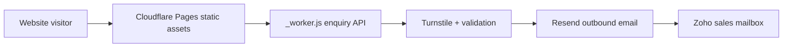
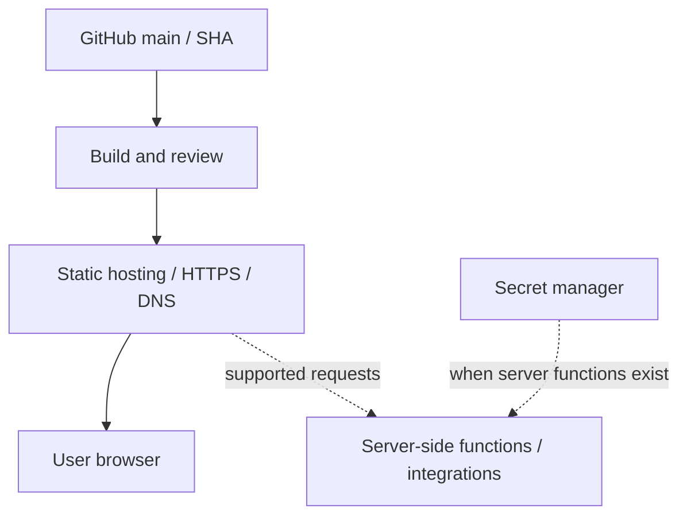

# SS Circuit Products website - Architecture, Deployment, Data, Maintenance & KT Handover
> Repository snapshot: **2026-11-09**. [bv-prasanna/sscp](https://github.com/bv-prasanna/sscp) / default branch `main`. Source inventory is not production deployment proof.

## 1. System and application architecture
**Observed scope:** Cloudflare Pages static site + _worker.js enquiry endpoint, Resend, Turnstile; no database. RFQ email and attachments: protect Resend key and Turnstile secret; verify Zoho inbox, origin checks, attachment size, spam controls and live send/receive.

Data flow boundaries: browser inputs and uploads are untrusted; client storage is not a server database; API-side validation, anti-spam, managed secrets, authorization and privacy retention must be implemented before treating a prototype as production.

## 2. Deployment diagram - reference

Complete DEV / UAT / PROD inventory with domain, DNS/TLS, deployment SHA, hosting project, runtime/version, secret owner, CDN cache, monitoring, tested rollback, responsible support contact and external service status. Do not claim those values are verified by this document.

## 3. ER and database schema
**Default-branch assessment:** no versioned relational database SQL schema or migration directory was identified in the inspected repository. Therefore, a physical ER diagram and table schema are **not applicable / not verifiable** here. Do not invent CUSTOMER/ORDER/ROLE tables solely to populate a diagram.

Website submissions/transient form payloads must not be described as SQL tables unless server-side persistent storage is added.

## 4. Database migration script
```bash
#!/usr/bin/env bash
set -euo pipefail
echo "No repository-verified database migration target or DDL in this project."
echo "Do not apply SQL. First approve data storage technology, schema baseline,"
echo "backup/restore strategy, migration framework and production environment."
exit 0
```
If persistence is introduced, add forward-only reviewed migrations, an explicit backup and restore rehearsal, version/checksum tracking, staging tests and a rollback/forward-fix plan. Do not use this no-op script to claim migrations have been completed.

## 5. Build and deployment runbook
1. Pin an approved git SHA and review applicable application scripts/config; treat template/development files separately from production.
2. Run local tests/build/quality gates and any browser/a11y checks; confirm privacy and performance on mobile and desktop.
3. Configure host, DNS/TLS and safe environment secrets (never publish credentials); verify security headers and CORS / origin policy.
4. Deploy to UAT first; complete smoke tests for every public page, form/API and error state; inspect logs and delivery receipts.
5. Promote the same reviewed artifact to production; record release owner and previous known-good version.
6. Monitor, confirm customer-facing behavior and rehearse rollback before accepting handover.

## 6. Ongoing maintenance and incident plan
- Daily: uptime/public routes, broken links, console errors, form delivery, spam and access anomalies, email service quota and build status.
- Weekly: check DNS/TLS, cache and asset integrity, SEO/crawl if public, analytics privacy, backup/export for browser-local state, dependency alerts.
- Monthly: patch dependencies, verify privacy and retention, rotate service credentials where policy requires, accessibility regression and incident exercise.
- Incident: capture failing URL, correlation or email provider trace, deployment SHA and impact; disable unsafe form processing if needed; roll back artifacts; verify recovery and document root cause.

## 7. KT demo and UAT
**Demo:** Product/capabilities -> RFQ form with safe test attachment -> Turnstile -> enquiry email.
| Time | Outcome |
|---|---|
| 0-10m | Scope, users, production/UAT status and known gaps |
| 10-25m | Site/app walkthrough, main flow and actual feedback messages |
| 25-40m | Architecture, security, data lifecycle, third-party services |
| 40-50m | Build, deploy, environment configuration, rollback and migration N/A |
| 50-60m | Monitoring, incidents, backup/export, ownership and signoff |

**Negative tests:** invalid route, unavailable API, missing mandatory fields, HTML injection, CSRF/origin failure, upload too large/malicious extension (if supported), email provider timeout/retry, data loss / stale localStorage, expired domains/certs, mobile layout issues and accessibility checks.

## 8. Handover acceptance checklist
- [ ] Correct source SHA/branch and owner; build/CI test evidence
- [ ] Environment registry, DNS, custom domain, hosting and TLS verified
- [ ] Sensitive keys transferred through vault only; no source-embedded secrets
- [ ] Main and negative user journeys tested with clear user messages
- [ ] Monitoring, privacy, data retention and incident contacts assigned
- [ ] Restore/export path and rollback rehearsal completed
- [ ] All provisional architecture/database items verified or entered as issues

## 9. Related files found
- No architecture/deployment reference artefact detected by filename.
- Source: [`assets/favicon.png`](../../assets/favicon.png)
- Source: [`assets/hero-leadframe.svg`](../../assets/hero-leadframe.svg)
- Source: [`assets/product-custom.svg`](../../assets/product-custom.svg)
- Source: [`assets/product-leadframe.svg`](../../assets/product-leadframe.svg)
- Source: [`assets/product-packaging.svg`](../../assets/product-packaging.svg)
- Source: [`assets/quality-chip.svg`](../../assets/quality-chip.svg)
- Source: [`assets/social-card.png`](../../assets/social-card.png)
- Source: [`assets/sscp-logo-approved.png`](../../assets/sscp-logo-approved.png)
- Source: [`assets/sscp-logo-approved.webp`](../../assets/sscp-logo-approved.webp)
- Source: [`assets/sscp-logo-icon.png`](../../assets/sscp-logo-icon.png)
- Source: [`assets/sscp-logo-icon.webp`](../../assets/sscp-logo-icon.webp)

*Documented only what the default-branch inventory supports; revisit upon feature implementation or new release.*
