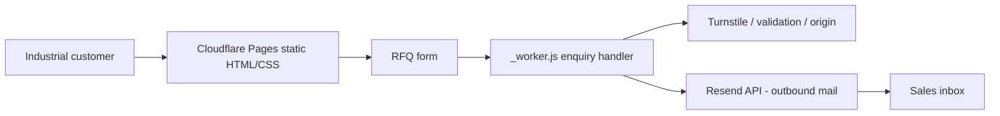

# SS Circuit Products — reverse-engineered source map and KT

> **Repository:** [`bv-prasanna/sscp` `main`](https://github.com/bv-prasanna/sscp/tree/main), inspected 10 November 2026. Architecture recovered from actual file paths and existing README; **deploy status, email setup and real browser behavior remain unverified.**

## Architecture
**Scope:** Static Cloudflare Pages / Worker quotation website.

The website handles potentially sensitive RFQ files and contact details: validate upload limits, Turnstile, allowed origins, server-side secret handling, approved attachments and real email delivery. No SQL DB was found.

## Code inventory
| Dimension | Files matched |
|---|---:|
| JS/TS source and function files | 0 |
| HTML/page entries | 8 |
| Test/spec-related source/doc files | 1 |
| Configuration/deployment source | 2 |

### User-facing pages
- [`404.html`](https://github.com/bv-prasanna/sscp/blob/main/404.html)
- [`about.html`](https://github.com/bv-prasanna/sscp/blob/main/about.html)
- [`capabilities.html`](https://github.com/bv-prasanna/sscp/blob/main/capabilities.html)
- [`contact.html`](https://github.com/bv-prasanna/sscp/blob/main/contact.html)
- [`index.html`](https://github.com/bv-prasanna/sscp/blob/main/index.html)
- [`privacy.html`](https://github.com/bv-prasanna/sscp/blob/main/privacy.html)
- [`products.html`](https://github.com/bv-prasanna/sscp/blob/main/products.html)
- [`quality.html`](https://github.com/bv-prasanna/sscp/blob/main/quality.html)

### Main application code and server-side handlers
- No JS/TS code identified by source-tree convention.

### Configuration, tests and deployment artifacts
- [`_headers`](https://github.com/bv-prasanna/sscp/blob/main/_headers)
- [`_worker.js`](https://github.com/bv-prasanna/sscp/blob/main/_worker.js)
- [`tests/worker.test.mjs`](https://github.com/bv-prasanna/sscp/blob/main/tests/worker.test.mjs)

## Data storage and migration applicability
**No committed versioned relational schema migration was identified in `main`.** Do not fabricate PostgreSQL tables or migration scripts for this site. The source of truth is the exact static HTML pages and the server-side `_worker.js` email handler.
RFQ fields and attachments are transient request/email records, not SQL rows. Use provider delivery logs and privacy retention policy as the operational data record.
[Earlier architecture, deployment, database applicability and KT guide](README.md).

## Source-to-operations validation checklist
1. Enumerate actual public URLs/HTML routes, browser viewport/accessibility and client-side state with smoke tests.
2. Trace contact or job interaction to the exact handler (if used). Verify status codes, validation, network timeout, spam controls and **user-friendly** errors.
3. Ensure no secrets in HTML/client bundles, test safe HTTP headers, CSRF/origin policy, rate limiting and privacy handling.
4. Pin approved commit, create verified production build, deploy staging and test external service deliveries using test data.
5. Document real DNS, Cloudflare/hosting account, env vars **without values**, delivery service setup, logs, alert owner and rollback deployment.
6. Sign off UAT in desktop/mobile browser; negative tests include broken links, invalid forms, unavailable email provider, oversized file uploads if enabled, cross-origin access, storage loss, missing permission and accessibility.

## KT demo
Walk through key screens; describe architecture and trust boundaries; demonstrate test enquiry or local export, expected friendly errors, deployment/build commands, smoke tests, monitoring and recovery. Confirm owners and escalation contacts. **Do not claim live delivery or synchronisation unless a real test confirms it.**